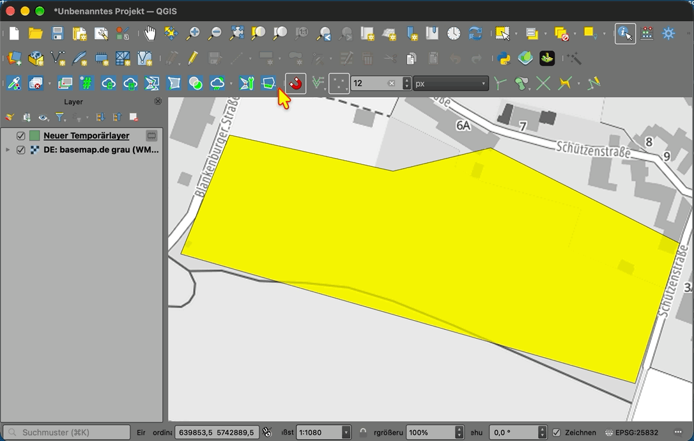
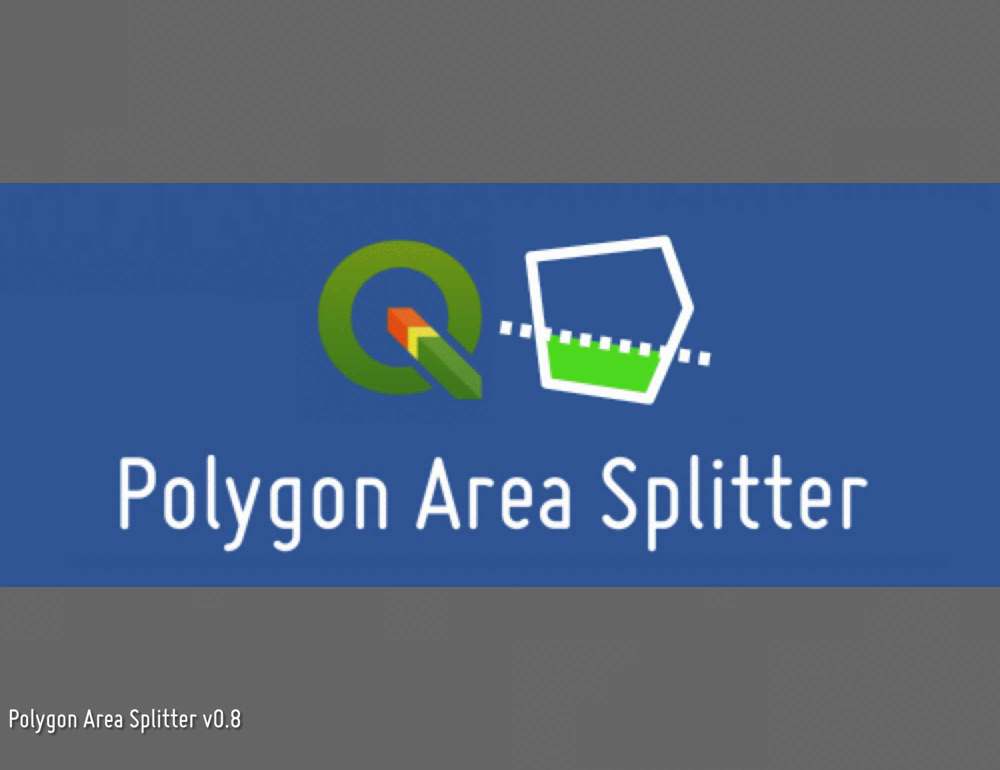

# QGIS-Plugin: Polygon Area Splitter

Plugin by Mike Elstermann (#geoObserver) with AI-Support.

## Features
- Works with QGIS3/ QGIS4 (Qt 5 or Qt 6 builds) and is written against `qgis.PyQt`.
- Automatically uses German when QGIS's configured locale is German; otherwise English.
- Requires exactly one selected polygon in an active polygon layer.
- Requests a target area in square metres.
- Click an outer boundary edge to define the direction of a parallel cut.
- Creates a new temporary output layer with a target part and the remainder.
- Labels both output polygons with their area.
- Does not edit the source layer.

## Installation
1. In QGIS, open **Plugins → Manage and Install Plugins…**
2. Choose **Install from ZIP**.
3. Select `PolygonAreaSplitter.zip`.
4. Activate the plugin from the Plugins menu or the `geoObserverTools` toolbar.

## Notes
- Use a projected CRS with metre units (for example EPSG:25832).
- The algorithm uses planar geometry and area in the layer CRS.
- Complex concave geometries, holes, multipart polygons, or very narrow shapes can produce disconnected pieces or make a requested area unreachable from the selected edge. Inspect the output before using it in production.
- Output is a temporary memory layer. Save it to a permanent data source if you need to keep it.
- Compatibility with QGIS 4 should be verified against an actual QGIS 4 installation.

## AI assistance / warranty
This file contains code generated with assistance from an AI. No warranty is provided. Human review and modification performed by Mike Elstermann (#geoObserver).

**Simple Workflow:**

1. Activate the feature layer containing the polygons, e.g. the parcels or arable land
2. Select exactly one polygon in this feature layer
3. Enter the desired target size
4. Click on the edge from which the new area is to be split
5. Use the result in the new temporary polygon layer that has been created

**News for v0.6 ... v0.8:**

* 0.6 - Collecting the split polygons
* 0.7 - Collecting the reference edges, assigning symbols to division polygons, pre-assigning original area values, selecting m² or ha, assigning IDs, adding IDs to the labels
* 0.8 - Area can also be entered as a percentage; In addition to the target variable “area,” two new target variables: “number of identical subareas” and “distance”

